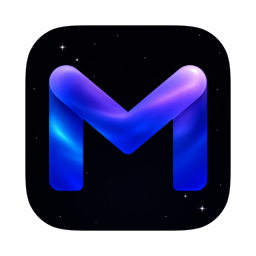
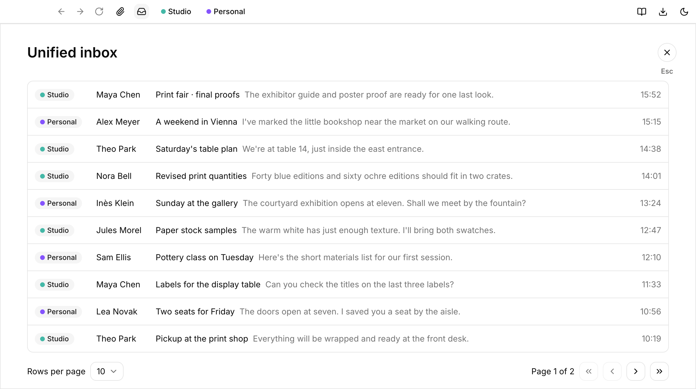
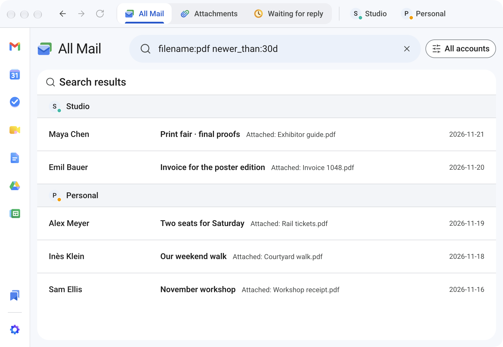
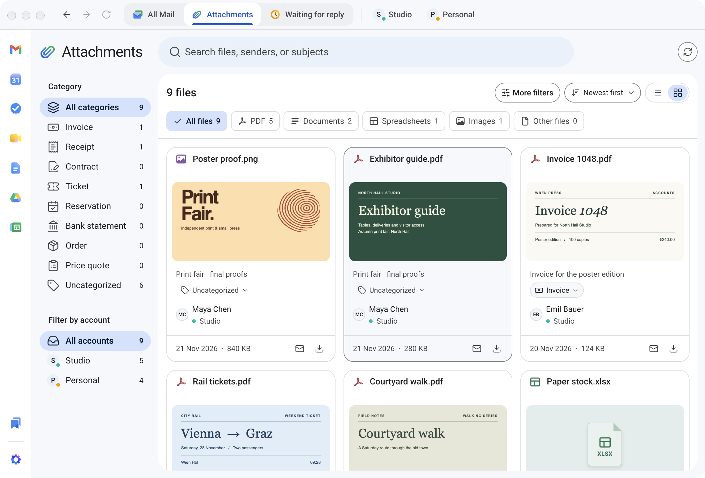
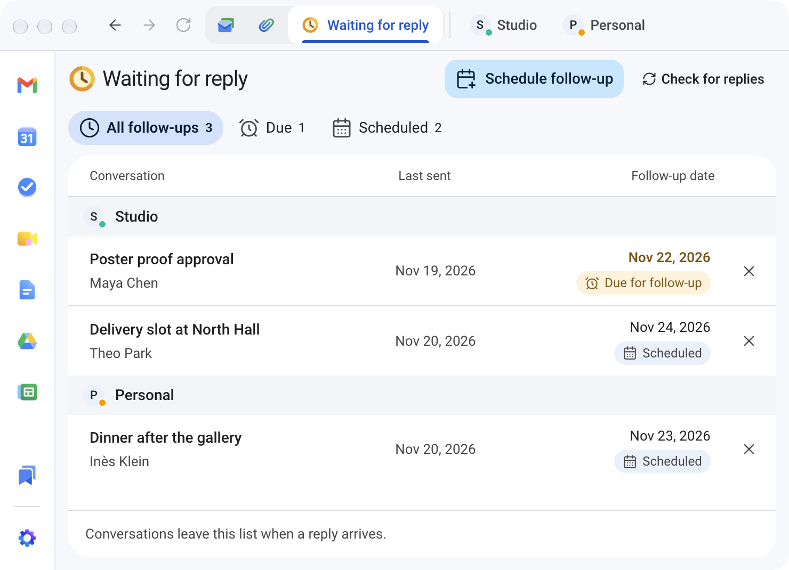
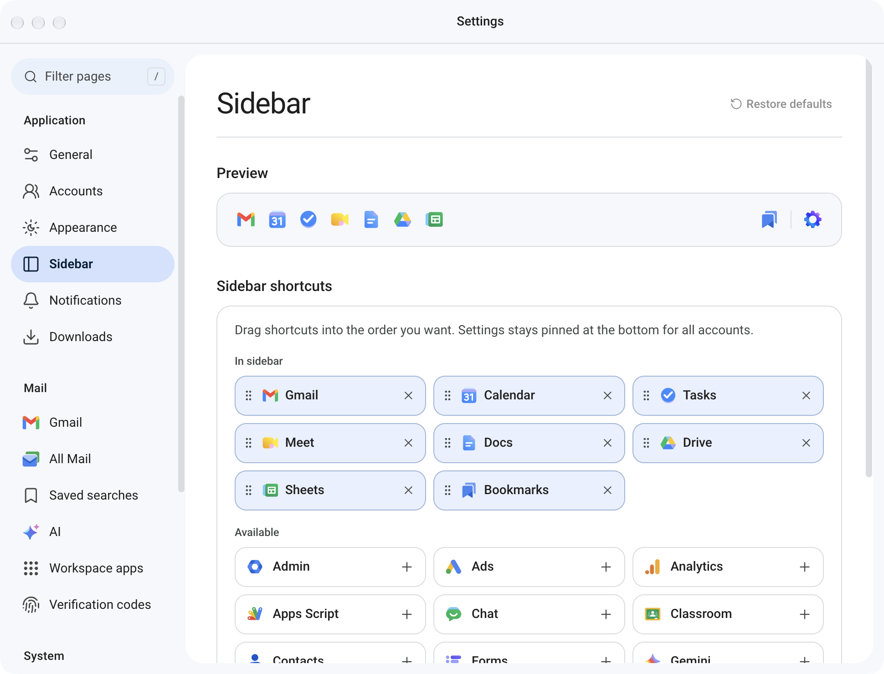

<p align="center">
  
</p>

<h1 align="center">ggmail</h1>

<p align="center">Gmail for Mac, with one inbox for your personal and work accounts.</p>

<p align="center">
  <a href="https://github.com/salexandr0s/ggmail/releases/latest/download/ggmail-mac-arm64.dmg"><strong>Download for Apple silicon</strong></a>
  &nbsp;·&nbsp; macOS 13 or later &nbsp;·&nbsp;
  <a href="https://github.com/salexandr0s/ggmail/releases/latest">Release notes</a>
</p>

Read and reply in Gmail as usual, or open **All Mail** to see unread messages from every connected inbox. You can find an attachment without remembering who sent it, keep track of conversations that need a reply, and ask the optional mail assistant to help draft one.

<picture>
  <source media="(prefers-color-scheme: dark)" srcset="docs/screenshots/unified-inbox-dark.png">
  
</picture>

_The screenshots use fictional accounts, messages and files._

## Get started

1. Open the downloaded disk image, drag **ggmail** into **Applications**, then launch it and sign in to Gmail.
2. To connect another mailbox, open **Settings → Accounts → Add**. Give the account a label, then select it in the title bar to sign in.
3. Choose **All Mail** in the title bar to see both inboxes. In a small window, open **Mail views** to reach All Mail, Attachments and Waiting for reply.

## Search across accounts

Press `/` in All Mail and enter a Gmail query. For example, `filename:pdf newer_than:30d` finds conversations with PDFs from the past 30 days. Press `Enter` to search. Results appear under each account as it responds. Open a result to read the conversation in its original mailbox. **Back** returns you to your place.

<details>
  <summary>See the same search across two mailboxes</summary>

  <picture>
    <source media="(prefers-color-scheme: dark)" srcset="docs/screenshots/search-dark.png">
    
  </picture>
</details>

Save queries you use often in **Settings → Saved searches**. To browse unread mail with the keyboard, use `J` and `K` to move between messages and `Enter` to open one.

## Find an attachment

Open **Attachments** when you remember the file better than the email. Search by filename, sender or subject, or combine a category such as **Invoice** with the **PDF** file type. Use **More filters** for dates, size or an exact extension. In a small window, these controls are under **Filters**.

<picture>
  <source media="(prefers-color-scheme: dark)" srcset="docs/screenshots/attachments-dark.png">
  
</picture>

Click a file to preview it or use the envelope icon to open its email. The file list is saved on your Mac, so you can browse previously found attachments while ggmail checks for new ones.

## Follow up on a conversation

When you’ve sent the last message and need an answer, open that conversation and choose **Waiting for reply → Schedule follow-up**. Pick a date. Due conversations appear in All Mail after ggmail checks for replies, and a conversation leaves the follow-up list when a reply arrives.

<picture>
  <source media="(prefers-color-scheme: dark)" srcset="docs/screenshots/waiting-for-reply-dark.png">
  
</picture>

## Draft a reply with the mail assistant

Connect a provider in **Settings → AI**. You can use a ChatGPT subscription, a signed-in Claude Code CLI session, or an API key for Claude, OpenAI or DeepSeek. When you ask a question, your chosen provider receives the chat and relevant mail.

Open an email and select **Mail assistant** in the title bar. Ask what the sender needs, open a citation to check the original wording, or ask for a draft. **Insert into reply** puts the draft into the Gmail thread for you to edit and send. For a new email, **Open in Gmail** fills in the recipients, subject and message.

With OpenAI, ChatGPT and Claude models, the assistant can search the web for public details, such as a business’s contact address. Turn this off with **Search the web** in **Settings → AI**.

<picture>
  <source media="(prefers-color-scheme: dark)" srcset="docs/screenshots/mail-assistant-dark.png">
  
</picture>

## Choose your sidebar shortcuts

The sidebar opens Calendar, Tasks, Meet, Docs, Drive and Sheets for the selected account. In **Settings → Sidebar**, use **+** to add a shortcut, **×** to remove it, or drag its handle to change the order. To reorder with the keyboard, focus a handle, press `Space`, move it with the arrow keys, then press `Space` again.

<picture>
  <source media="(prefers-color-scheme: dark)" srcset="docs/screenshots/sidebar-dark.png">
  
</picture>

You can move or remove Bookmarks. Settings stays pinned at the bottom. To customize the title bar launcher separately, open **Settings → Workspace apps**.

For darker message and compose windows, enable **Settings → Gmail → Extend dark theme**. Choose **Original colors** above an individual message to see the sender’s design.

## Build from source

On an Apple silicon Mac with Bun 1.4, Node.js 24 and the Apple Command Line Tools installed, run the following from the project directory to build a development copy and open it with a separate test profile.

```sh
bun install --frozen-lockfile --ignore-scripts
DEVELOPER_DIR=/Library/Developer/CommandLineTools bun run build:mac:local --adhoc
open -n dist/adhoc/mac-arm64/ggmail.app --args --user-data-dir="$PWD/.ggmail/dev-profile"
```

For Developer ID signing, local installation and tests, see the build guide. [Local build guide](LOCAL-BUILD.md) · [Changelog](CHANGELOG.md)

Gmail and its icon are trademarks of Google LLC. ggmail is an independent project.
