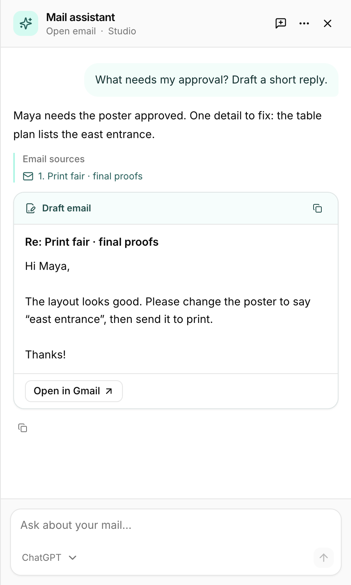

# ggmail

[Download ggmail for Mac with Apple silicon](https://github.com/salexandr0s/ggmail/releases/latest/download/ggmail-mac-arm64.dmg). Open the disk image and drag ggmail into Applications. Requires macOS 13 or later.

ggmail is a desktop app for Gmail. The unified inbox brings unread mail from all your accounts into one list. Select a message to open the conversation in its own account, or use `J` and `K` to move through the list and `Enter` to open it.

To find mail across accounts, enter a Gmail query such as `filename:pdf newer_than:30d` in **Search all accounts** and press **Enter**. You can also choose a saved search in the unified inbox. Results appear as each mailbox responds. Use **All accounts** to narrow the list, or clear the search to return to unread mail.

<picture>
  <source media="(prefers-color-scheme: dark)" srcset="docs/screenshots/unified-inbox-dark.png">
  
</picture>

_The screenshots use fictional mailboxes and files. The assistant conversation is an example._

## Read and compose in dark colors

Turn on **Settings → Gmail → Extend dark theme** to apply it to open messages, replies and compose windows immediately. Select **Original colors** above an email to see its sender’s design. Select it again to return to dark colors. Drafts keep the formatting you send.

## Find an attachment

Select the paperclip or open **View → Attachments**. Search by filename, sender, or subject, then narrow the results by account or file type. Select a thumbnail or filename to preview the file in the library. The envelope opens the original email.

<picture>
  <source media="(prefers-color-scheme: dark)" srcset="docs/screenshots/attachments-dark.png">
  
</picture>

## Draft a reply with the mail assistant

Open **Settings → AI** and choose **Claude Code CLI (Subscription)** to use the Claude Code account signed in on this computer. You can also connect a ChatGPT subscription or enter an API key for Claude, OpenAI, or DeepSeek.

Select the sparkle in the title bar to search your signed-in mailboxes. The assistant can read a full conversation to find a deadline or prepare a reply. Your chosen provider receives your prompt and the relevant mail. Choose **Insert into reply** to place a draft in the open thread. Gmail fills in the recipients and keeps the reply ready for you to edit and send. You can also ask for revisions, copy the draft, or start a separate message with **Open in Gmail**.

<picture>
  <source media="(prefers-color-scheme: dark)" srcset="docs/screenshots/mail-assistant-dark.png">
  
</picture>

## Build on Apple Silicon

Install Bun 1.4, Node.js 24, and the Apple Command Line Tools. From the project directory, run

```sh
bun install --frozen-lockfile --ignore-scripts
DEVELOPER_DIR=/Library/Developer/CommandLineTools bun run build:mac:local
open dist/mac-arm64/ggmail.app
```

Sign in to Gmail on first launch. ggmail uses its own account profile. For signing details and verification commands, see the [local build notes](LOCAL-BUILD.md).

Gmail and its icon are trademarks of Google LLC. ggmail is an independent project.
